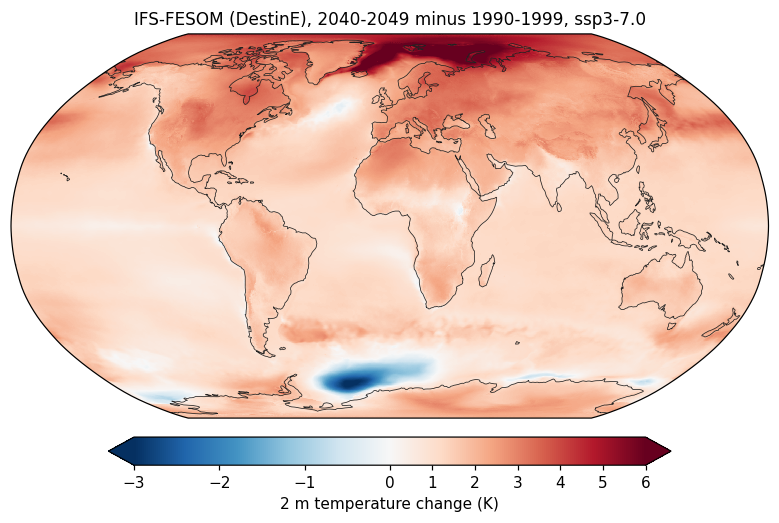

# cdors on Levante

**cdors runs CDO's analysis operators, many times faster.** Same commands as cdo, on Zarr, kerchunk and NetCDF.
cdors reads only the chunks it needs, in parallel, reads the EERIE cloud (cdo cannot), and shows what a run will
read before it runs. It is a prototype (0.1.0, October 2026): 207 operators, each compared with cdo 2.6.0 or, where
cdo has no counterpart, with regionmask, nereus or NumPy.

The same command with cdo and with cdors, wall time on one Levante compute node:

| Command | Data | cdo | cdors | Faster |
|---|---|---|---|---|
| `ydaymean`, 30 years of 3-hourly global data | 1.1 TB | 1 h 35 min | 79 s | **72×** |
| `timpctl,95`, one year of 3-hourly global data | 38 GB | 6 min 56 s | 8.6 s | **49×** |
| `fldmean` of a region, 240 NetCDF files | 15 GB | 38.5 s | 3.6 s | **11×** |
| `remap` to 1°, 120 NetCDF files | 7.6 GB | 23.7 s | 2.8 s | **8.6×** |
| `yearmean`, a decade of daily global data | 46 GB | 42.8 s | 7.8 s | **5.5×** |

Global data: nextGEMS ICON, 3.1 million HEALPix cells. The results agree with cdo's. On tiny files cdo is faster
(cdors needs 0.2–0.3 s to start). Details: `doc/bench-results.md`.

On the 6 km DestinE projections: 60 years of global-mean temperature from 36 GB in 6–20 s (cdo: about a minute), and
a 6 km warming map in 15 s (see "Larger problems").

On FESOM2's own mesh (AWI-CM3, 3.2 million nodes): three years of daily Arctic sea-ice extent in 7.1 s, 18× faster
than nereus, and the Atlantic heat content 0–700 m in 8.3 s, 8.3× faster, with the same values (Example 7).

## Try it

Start on a login node. One line makes `cdors` available; then try it: the July mean of 2 m temperature over Europe
(10°W–40°E, 35–70°N) for five years, from 30 years of daily global data:

```bash
export PATH=/work/ab0995/a270088/cdors/bin:$PATH     # add to ~/.bashrc to keep it

D=/work/kd1453/rechunked_ngc4008/ngc4008_P1D_9.zarr
cdors outputtab,date,value -yearmean -fldmean -sellonlatbox,-10,40,35,70 -selmon,7 -selyear,2020/2024 -selname,tas $D
```
```
#      date    value
 2020-07-16 291.8761
 2021-07-16 292.4609
 2022-07-16 292.7205
 2023-07-16 292.4945
 2024-07-16 292.9499
```

That took 0.6 s on a login node. Data: nextGEMS ICON `ngc4008`, daily, 3,145,728 HEALPix cells, 2020–2049. cdors
read 60 of the 17,568 chunks of `tas` (0.47 GB).

The examples go from small to large. Examples 1–7 ran on a login node, the larger problems after them on an
interactive node with 128 CPUs (2026-10-09) or a compute node (FESOM2, 2026-10-19).

## Example 1: look at a dataset

```bash
D=/work/kd1453/rechunked_ngc4008/ngc4008_P1D_9.zarr
cdors showname $D
cdors sinfo $D
```
```
   File format : Zarr v2
    -1 : T Levels    Points Dtype   Chunks               : Parameter name
     1 : v     73   3145728 float32 7x11x65536           : A_tracer_v_to
     2 : v      1   3145728 float32 30x65536             : FrshFlux_IceSalt
   ...
   Grid coordinates :
     1 : healpix                  : points=3145728 nside=512 order=Nested
   Vertical coordinates :
     1 : depth_half               : levels=73 units=m
   ...
   Time coordinate :
                             time : 10958 steps
     Units = seconds since 1970-01-01  Calendar = proleptic_gregorian
     First = 2020-01-02T00:00:00  Last = 2050-01-01T00:00:00
```

As JSON, for one variable:

```bash
cdors --json sinfo $D | jq '.variables[] | select(.name=="tas") | {units, shape, chunks, codecs}'
```
```json
{
  "units": "K",
  "shape": [10958, 3145728],
  "chunks": [30, 65536],
  "codecs": "blosc:lz4"
}
```

## Example 2: one point, a 95th percentile

95th percentile of 3-hourly 2 m temperature at Hamburg in 2020, from the 1.1 TB 3-hourly store:

```bash
H3=/work/kd1453/rechunked_ngc4008/ngc4008_PT3H_9.zarr
cdors outputtab,date,lon,lat,value -timpctl,95 -remapnn,lon=10_lat=53.55 -selyear,2020 -selname,tas $H3
```
```
#      date    lon    lat    value
 2020-07-02     10  53.55   292.12
```

2.3 s the first time, mostly cdo making the weights, which are then cached. cdors reads only the 12 of 67,968 chunks
that hold this cell in 2020 (195 MB). Percentiles are exact for any number of values; cdo approximates above 50 per
cell.

## Example 3: remap to a regular grid

HadGEM3 (CMIP6) sea surface temperature from the curvilinear ORCA1 grid to 1°, 2000–2014 mean:

```bash
F=/work/ik1017/CMIP6/data/CMIP6/CMIP/MOHC/HadGEM3-GC31-LL/historical/r1i1p1f3/Omon/tos/gn/v20190624/tos_Omon_HadGEM3-GC31-LL_historical_r1i1p1f3_gn_195001-201412.nc
cdors -remapbil,r360x180 -timmean -selyear,2000/2014 $F tos_clim_1deg.nc
```

3.9 s the first time, while cdo makes the weights (cached in `$CDORS_CACHE`), 0.5 s after. `remapnn`, `remapdis`,
`remapbil`, `remapcon` and `remapycon` take cdo's grid names (`r360x180`, `global_1`, `hpz7`, `lon=10_lat=53.55`,
...), grid description files or another dataset's grid; `remap,<grid>,<weights.nc>` uses your own weights.

## Example 4: EERIE data — kerchunk references, raw NetCDF files, the cloud, GRIB

ICON-ESM-ER (`eerie-control-1950`), daily, 0.25°, read three ways; then IFS-FESOM, stored as GRIB.

**Kerchunk references** from the DKRZ EERIE catalog (Parquet):

```bash
K=/work/bm1344/k202193/Kerchunk/erc2002/control_1950/v20240618/atm_2d_1d_mean_remap025.parq
cdors outputtab,date,value -mulc,86400 -monmean -fldmean -sellonlatbox,-60,0,20,60 -selyear,1950 -selname,pr $K
```
```
#      date    value
 1950-01-16 3.164306
 1950-02-15 3.216423
 ...
 1950-12-16 3.669047
```

North Atlantic precipitation in mm/day per month of 1950, in 1.8 s.

**Raw NetCDF files.** A quoted glob is one input; cdors sorts the files and joins them along time:

```bash
R=/work/bm1344/k202193/ICON/erc2002/postprocessing/interpolation/control_1950/atm_2d_1d_mean_remap025
cdors -fldmean -sellonlatbox,-60,0,20,60 -selname,pr "$R/run_199[1-5]*/*.nc" pr_natl.nc
```

120 files, five years, 7.6 GB. The first run takes 20–60 s while cdors indexes the files (kept in
`$CDORS_CACHE`); later runs about 3 s. These files carry the model's own years: 1991 here is 1950 in the catalog.

**The EERIE cloud**: the same dataset over HTTPS, from anywhere:

```bash
U=https://eerie.cloud.dkrz.de/datasets/icon-esm-er.eerie-control-1950.v20240618.atmos.gr025.2d_daily_mean/kerchunk
cdors sinfo $U
cdors outputtab,date,value -timmean -fldmean -sellonlatbox,-10,40,35,70 -selmon,1 -selyear,1950 -selname,tas $U
```
```
#      date    value
 1950-01-16 274.6871
```

1.8 s from the cloud, 0.8 s from the kerchunk references, same value. The server gives about 0.2 GB/s. Datasets:
`https://eerie.cloud.dkrz.de/datasets`. cdo cannot read these URLs.

**GRIB through gribscan references**: IFS-FESOM (`hist-1950`), monthly means on pressure levels, 0.25°, stored as
GRIB messages with references made by gribscan:

```bash
G=/work/bm1344/k202193/Kerchunk/IFS-FESOM_sr/3D_monthly_0.25deg_atmos_avg.parq
cdors outputtab,date,value -fldmean -sellevel,85000 -selyear,1950 -selname,mt $G
```
```
#      date    value
 1950-01-15 279.185209266673
 ...
 1950-12-15 279.269668279689
```

Global mean temperature at 850 hPa per month of 1950, in 0.6 s; all 684 months to 2006 take 1.3 s. cdors decodes the
GRIB messages itself and puts gribscan's flattened grid back on its 1440 × 721 lon-lat grid, so the mean is
area-weighted, as cdo's. cdo 2.6.0 cannot read these messages at all (cdo 2.5.0 can: 13 s for the 684 months, the
same values). The references stamp monthly means mid-month; cdo stamps them at the end of the month. The native
O1280 grid (`gribscan_1m_NATIVE`) works too: cdors weights its reduced Gaussian rows by cell area, and the January
1950 global mean skin temperature agrees with the 0.25° one to 0.0001 K. From 2007 on, the files these references
point to are gone; cdors names the missing file and the time step.

## Example 5: scripts and agents

Every command takes `--json`: values as one JSON object, errors as one JSON object on stderr with a code and a hint:

```bash
cdors --json outputtab,date,value -fldmean -seltimestep,1/3 -selname,tas $D | jq -c '.records'
```
```json
[{"date":"2020-01-02","value":286.30957},{"date":"2020-01-03","value":286.11243},{"date":"2020-01-04","value":285.9965}]
```
```bash
cdors --json -yearmaen in.nc out.nc
```
```json
{"error":"unknown_operator","message":"unknown operator 'yearmaen'","operator":"yearmaen","suggestions":["yearmax","yearmean","yearmin"],"exit_code":1,"retryable":false,"hint":"did you mean yearmax or yearmean or yearmin?"}
```

From Python 3.7 or newer:

```python
import json, subprocess

D = "/work/kd1453/rechunked_ngc4008/ngc4008_P1D_9.zarr"
cmd = ["cdors", "--json", "outputtab,date,value", "-fldmean", "-sellonlatbox,-10,40,35,70",
       "-selmon,7", "-selyear,2020", "-selname,tas", D]
r = subprocess.run(cmd, capture_output=True, text=True)
if r.returncode != 0:
    raise RuntimeError(json.loads(r.stderr.splitlines()[-1])["message"])
records = json.loads(r.stdout)["records"]    # 31 records: {'date': '2020-07-01', 'value': 291.0806}, ...
```

Exit codes:

| Code | Meaning |
|---|---|
| 0 | success |
| 1 | the command is wrong (unknown operator, bad arguments, missing input, ...) |
| 2 | the data are the problem (bad data, unsupported grid, memory limit, ...) |
| 3 | an I/O error worth retrying (timeouts, HTTP 5xx) |
| 4 | refused (read limit, too many values, existing output) |

AI agents can start with `cdors guide` (5 kB, written for them). With it, agents answered five of five test analyses
correctly, 4× faster than with cdo and Python, at 1.3× the cost. Full reference: `doc/reference.md`.

## Example 6: plan first, then run

A monthly climatology over ten years:

```bash
cdors --plan -ymonmean -selyear,2020/2029 -selname,tas $D tas_ymonmean.nc
```
```
inputs: /work/kd1453/rechunked_ngc4008/ngc4008_P1D_9.zarr
output: tas_ymonmean.nc (nc4)
stage 1 of 1: selname,tas -> selyear,2020/2029 -> ymonmean, folded by ymonmean along time, 1 pass(es)
  read: 5856 chunks, 46.1 GB decoded, ~25.7 GB stored (estimate from 8 chunks); 5856 tiles
memory: ~2.9 GB peak of 4.3 GB budget (...)
settings: 16 compute threads, 64 reads in flight (login node)
read limit: 64.0 GB (login-node default, no SLURM_JOB_ID)
```

46 GB is under the login node's limit of 64 GB; it takes 5.8 s:

```bash
time cdors -ymonmean -selyear,2020/2029 -selname,tas $D tas_ymonmean.nc     # 5.8 s
cdors infon tas_ymonmean.nc
```
```
    -1 :       Date     Time   Level Gridsize    Miss :     Minimum        Mean     Maximum : Parameter name
     1 : 2029-01-31 00:00:00       0  3145728       0 :      226.34      284.85      304.57 : tas
     2 : 2029-02-28 00:00:00       0  3145728       0 :      226.70      285.21      306.14 : tas
   ...
```

Ordinary CF NetCDF, readable by cdo and xarray. For ushow, add `--lonlat` to write the HEALPix cell centres too (25
MB here):

```bash
cdors --lonlat -ymonmean -selyear,2020/2029 -selname,tas $D tas_ymonmean.nc
ushow tas_ymonmean.nc
```

`info`, `infon`, `output`, `outputf` and `outputtab` print any chain's result in cdo's format, up to a million
values (`--max-values`).

## Example 7: FESOM2 on its own mesh

FESOM2 writes ocean and sea-ice output on the nodes of an unstructured mesh, stores 0 below the sea floor and no
cell areas. `-setgrid,fesom:<mesh directory>` gives the data its mesh: areas at every level, the layers, and each
node's bottom. Levels below the bottom then count as missing, field means are area-weighted level by level, and
regions, histograms, volume integrals and sections become available.

**Small first: the PHC climatology on the pi mesh** (3140 nodes, 47 levels, 0.6 MB), a FESOM 2.0 file:

```bash
PI=/pool/data/AWICM/FESOM2/MESHES_FESOM2.1/pi
T=/pool/data/AWICM/FESOM2/climatology_PHC/pi/temp.fesom.1948.nc
cdors outputtab,date,value -volmean -setgrid,fesom:$PI $T                  # volume-mean temperature
cdors outputtab,value -mulc,4089750 -volint,0/700 -setgrid,fesom:$PI $T    # heat content 0-700 m, J
cdors outputtab,region_name,value -regmean,regions=basins -sellevel,2.5 -setgrid,fesom:$PI $T
```
```
#      date    value
 1948-01-01 3.719614
#   value
9.69479515529608e+24
#   region_name    value
Atlantic_Basin 20.54566
 Pacific_Basin 22.89125
  Indian_Basin  24.4556
  Arctic_Basin -0.8611676
Southern_Ocean_Basin 5.110318
Mediterranean_Basin   -9e+33
  Global Ocean 18.09277
Global Ocean 65N to 65S  19.4152
Global Ocean 15S to 15N 27.29529
```

0.1 s each. pi is too coarse to have a node in the Mediterranean, so that basin is missing, with a warning. This file
has no depth coordinate (cdo sees one grid of 147,580 points); `setgrid` gives it the mesh's levels, so level
selections go above `setgrid` here.

**A climate run: AWI-CM3** (`TCO319L137-DART/hist1950d`), one file per variable and year, on the dart mesh
(3,160,340 nodes, 79 levels). Monthly `temp` is 12 GB per year, daily `a_ice` 4.6 GB. (`TCO319L137-DART/hist1950d`), one file per variable and year, on the dart mesh (3,160,340 nodes,
79 levels). Monthly `temp` is 12 GB per year, daily `a_ice` 4.6 GB.

```bash
M=/pool/data/AWICM/FESOM2/MESHES_FESOM2.1/dart
F=/work/ab0995/a270210/runtime/awicm3-v3.1_refactoring/TCO319L137-DART/hist1950d/outdata/fesom
cdors mesh info fesom:$M
```
```
mesh fesom2:dart (fesom2)
  place nodes     3160340 cells, area sum 3.600464e14, wet levels 2..79, areas per level (80 levels, 2022617600 B, lazy)
  place elements  6262485 cells, area sum 3.600464e14, wet levels 2..79
  table elem_nodes (elements -> nodes), 125249708 B, lazy
  vertical: 79 levels, interfaces [-6550.0,-0.0], full layers
  units: radians: max |lat| 1.570482 <= pi/2 and max |lon| 3.141592 <= 2 pi (nodes has no units attribute; override with units=deg)
  ...
```

The first use of a mesh converts it into `$CDORS_CACHE/meshes/` (13 s and 1.2 GB for dart); after that it takes
0.6 s.

**Below the sea floor.** At 4100 m, 2,152,694 of the 3,160,340 nodes are in the ground. Without the mesh they are
zeros; with it they are missing:

```bash
cdors infon -sellevel,4100 -selmon,1 -selname,temp $F/temp.fesom.1975.nc
cdors infon -setgrid,fesom:$M -sellevel,4100 -selmon,1 -selname,temp $F/temp.fesom.1975.nc
```
```
    -1 :       Date     Time   Level Gridsize    Miss :     Minimum        Mean     Maximum : Parameter name
     1 : 1975-01-31 23:56:00    4100  3160340       0 :    -0.95207     0.22199      13.375 : temp
    -1 :       Date     Time   Level Gridsize    Miss :     Minimum        Mean     Maximum : Parameter name
     1 : 1975-01-31 23:56:00    4100  3160340 2152694 :    -0.95207     0.69624      13.375 : temp
```

**Sea ice.** Northern-hemisphere ice extent (the area where `a_ice` ≥ 0.15) and ice area per month of 1975, in
million km², from 365 daily fields:

```bash
cdors outputtab,date,value -mulc,1e-12 -monmean -selname,a_ice -fldhist,edges=0.15/1 \
  -sellonlatbox,-180,180,0,90 -setgrid,fesom:$M -selname,a_ice $F/a_ice.fesom.1975.nc
cdors outputtab,date,value -mulc,1e-12 -monmean -fldint \
  -sellonlatbox,-180,180,0,90 -setgrid,fesom:$M -selname,a_ice $F/a_ice.fesom.1975.nc
```
```
#      date    value
 1975-01-16 15.1062178626641
 1975-02-15 16.3297166887086
 1975-03-16 16.2105242359811
 ...
 1975-09-16 9.24912279716533
 ...
 1975-12-16 14.2145074531006
#      date    value
 1975-01-16 13.89501
 1975-02-15 14.97291
 1975-03-16 14.87076
 ...
 1975-09-16 7.518077
 ...
 1975-12-16 13.15417
```

2–3.5 s each (4.6 GB). `fldhist` counts the area per bin, here one bin [0.15, 1]; the area
below 0.15 goes to `a_ice_below` and is dropped here with `-selname,a_ice`. `fldint` keeps cdo's float32.

**Regions.** Surface temperature of July 1975 in nereus' ocean basins, and the monthly mean over the Niño 3.4 box for the year:

```bash
cdors outputtab,region_name,value -regmean,regions=basins -setgrid,fesom:$M -sellevel,2.5 -selmon,7 -selname,temp $F/temp.fesom.1975.nc
cdors outputtab,date,value -regmean,regions=nino,select=nino34 -setgrid,fesom:$M -sellevel,2.5 -selname,temp $F/temp.fesom.1975.nc
```
```
#   region_name    value
Atlantic_Basin 20.32537
 Pacific_Basin 23.10711
  Indian_Basin 22.74278
  Arctic_Basin -1.098592
Southern_Ocean_Basin 3.885819
Mediterranean_Basin 24.09919
  Global Ocean 17.82859
Global Ocean 65N to 65S 19.13921
Global Ocean 15S to 15N 26.88675
#      date    value
 1975-01-31 25.00394
 1975-02-28 25.27674
 ...
 1975-06-30 27.20209
 ...
 1975-12-31 25.26336
```

0.9 s and 1.1 s. A node belongs to a region if it lies inside the polygon (regionmask's rules; on dart the Atlantic
holds the same 924,967 nodes as in nereus). The sets: IPCC AR6 (`ar6.ocean`, `ar6.land`, `ar6.all`), SREX, Giorgi,
PRUDENCE and the Niño boxes are built in; nereus' `basins` and `moc` and Natural Earth's `ne.countries_50`,
`ne.ocean_basins_50`, ... are installed next to the program. `cdors help regmask` lists them with their licences.
`regint`, `regmin`, `regmax`, `regsum`, `regstd` work the same way, and `-maskregion,regions=<set>,select=<region>`
masks everything outside.

**Heat content.** Atlantic ocean heat content 0–700 m, in J, for January and February 1975 (ρ₀ c_p = 1025 × 3990
J m⁻³ K⁻¹, nereus' constants):

```bash
cdors outputtab,date,value -mulc,4089750 -volint,0/700 -maskregion,regions=basins,select=Atlantic_Basin \
  -setgrid,fesom:$M -selmon,1/2 -selname,temp $F/temp.fesom.1975.nc
```
```
#      date    value
 1975-01-31 2.25569643993631e+24
 1975-02-28 2.24903642120241e+24
```

1.1–1.3 s, 2.2 GB of memory. `volint,0/700` is Σ value × area × layer thickness over every wet node and layer down
to 700 m (a layer that crosses 700 m counts in part); `volmean` divides by the volume. Only the 36 layers above
700 m are read (910 MB of the 2 months' 2 GB). The output's units read `C m3`, because `-mulc` keeps units.

**A section.** Temperature through the Drake Passage, January 1975, nearest node, at the surface every 100 km:

```bash
cdors outputtab,distance,lat,value -transect,-65,-55,-60,-65,step=100 -setgrid,fesom:$M -sellevel,2.5 -selmon,1 -selname,temp $F/temp.fesom.1975.nc
```
```
#distance    lat    value
       0    -55 7.895102
95.44144 -55.83952 4.856841
190.8829 -56.67819  4.51521
 ...
1049.856 -64.17486 1.076849
1145.297    -65 -1.805974
```

Without `step` and the level selection, the section has every level and a point every 10 km (the median node
spacing), with `bottom_depth`, missing values below it and the layer bounds (`nz1_bnds`), so `vertint` or
`vertmean` can follow (1.4 s):

```bash
cdors -transect,-65,-55,-60,-65 -setgrid,fesom:$M -selmon,1 -selname,temp $F/temp.fesom.1975.nc drake.nc
```

`temp(time, nz1, distance)`, 79 × 117. One station works the same way:
`-selpoints,lon=-30_lat=55` gives `temp(time, nz1, station)`; at 30°W 55°N in July 1975, 11.75 °C at the surface
and 3.56 °C at 2000 m, and `-vertint,0/700 -selpoints,lon=-30_lat=55 ...` gives 3965 °C m over the top 700 m.

**Overturning and transports.** The Atlantic overturning streamfunction from `w`, and the transport through the
Drake Passage from `u` and `v`, January 1990:

```bash
cdors outputtab,lev,value -sellevel,0,950 -moc,lat=26.5,regions=moc,select=Atlantic_MOC -setgrid,fesom:$M \
  -selmon,1 -selname,w $F/w.fesom.1990.nc
cdors outputtab,value -vertsum -transport,-68,-54,-63,-65.5 -setgrid,fesom:$M -selmon,1 -selname,u $F/u.fesom.1990.nc \
  -setgrid,fesom:$M -selmon,1 -selname,v $F/v.fesom.1990.nc
```
```
#   lev    value
     0 0.216056168371139
   950 17.4749385415268
#   value
161.191441256385
```

Both are in Sv. `moc` sums `w` times the element areas north of each latitude and closes at the basin's northern
end, so at the surface it gives the net surface flow, 0.22 Sv, not 0. Subtract `-sellevel,0` of the same chain for
the transport above each depth. Without `lat=` the result is the whole streamfunction on 1° latitudes.

`transport` takes the velocity on the elements (`u`, `v`) or on the nodes (`unod`, `vnod`). The path should start
and end on land, and the sign is positive from the right of the path to its left, here eastward.

Each command takes about 1 s once the files are in Lustre's cache; the first read of the month of `w` (1 GB) took
27 s. Both agree with independent NumPy versions to 1e-12, and `--json` states the method.

All of these ran on a login node (16 threads). `cdors help <op>` explains the operators that cdo does not have
(`"origin": "cdors"` in `cdors ops --json`).

## Larger problems: an interactive node

When problems get large, with millions of cells per field over decades, move to an interactive node: there cdors
uses every core it gets and has no read limit. `salloc` opens a shell on the node; `exit` ends it, and the session
is billed while open:

```bash
salloc -p interactive -A <your project> -c 128 --mem=200G -t 01:00:00     # half a node: 64 cores
```

The DestinE examples below ran in such a session.

DestinE Generation 2 climate projections: monthly means on 12,582,912 HEALPix cells (about 6 km) from IFS-FESOM,
IFS-NEMO and ICON, 1990–2014 (historical) and 2015–2049 (SSP3-7.0). One Zarr store per variable and run; `228004` is
2 m temperature, 21 GB per run:

```bash
G=/work/ab0995/a270088/DestinE/GENERATION2_joint
ls $G/2D | head        # surface variables (high resolution); $G/3D: pressure levels and the ocean
H=$G/2D/baseline_hist_2_ifs-fesom_1_0001_clmn_high_sfc_228004.zarr
P=$G/2D/projections_ssp3-7.0_2_ifs-fesom_1_0001_clmn_high_sfc_228004.zarr
```

### Global warming in three models

One command per model, 36 GB each:

```bash
for m in ifs-fesom_1 ifs-nemo_1 icon_1; do
  cdors outputtab,date,value -yearmean -fldmean -mergetime \
    $G/2D/baseline_hist_2_${m}_0001_clmn_high_sfc_228004.zarr \
    $G/2D/projections_ssp3-7.0_2_${m}_0001_clmn_high_sfc_228004.zarr
done
```

60 annual global means each (`1990-06-16 287.522` ... `2049-06-16 289.0152` for IFS-FESOM), in 12 s, 16 s and 5.5 s.
The same with cdo, which needs brackets around the `-mergetime` inputs:

```bash
cdo -P 16 -outputtab,date,value -yearmean -fldmean -mergetime [ "file://$H#mode=zarr,file" "file://$P#mode=zarr,file" ]
```

On the same node, cdo took 66 s and cdors 20 s (in that session; the interactive nodes are shared, so times vary).
The results agree to 0.0001 K. Decadal means, in K:

| Decade | IFS-FESOM | IFS-NEMO | ICON |
|---|---|---|---|
| 1990s | 287.35 | 287.15 | 286.47 |
| 2000s | 287.55 | 287.26 | 286.75 |
| 2010s | 287.72 | 287.53 | 286.95 |
| 2020s | 288.11 | 287.72 | 287.14 |
| 2030s | 288.42 | 287.92 | 287.35 |
| 2040s | 288.88 | 288.31 | 287.52 |

The stores have no cell bounds, so all cells get equal weights, as in cdo; for HEALPix that is exact.

### A warming map at 6 km

2040s minus 1990s, all 12.6 million cells, in 15 s (12 GB):

```bash
cdors -sub -timmean -selyear,2040/2049 $P -timmean -selyear,1990/1999 $H dT.nc
cdors infon dT.nc
ushow dT.nc
```
```
    -1 :       Date     Time   Level Gridsize    Miss :     Minimum        Mean     Maximum : Parameter name
     1 : 2044-12-16 12:00:00       0 12582912       0 :     -3.1325      1.5266      8.8455 : avg_2t
```

`dT.nc` carries latitude and longitude, so ushow opens it directly.



*`dT.nc`, plotted with matplotlib on 0.25° boxes.*

### Hamburg, 60 years

Annual means at the nearest cell, 1990–2049:

```bash
cdors outputtab,date,value -yearmean -remapnn,lon=10_lat=53.55 -mergetime $H $P
```

21 s on the first run, while cdo makes the nearest-neighbour weights; 3.3 s after that. The 1990s average 281.16 K,
the 2040s 283.92 K.

### Ocean warming with depth

IFS-FESOM ocean temperature (`avg_thetao`, 69 levels, 196,608 cells), 2045–2049 minus 2015–2019, global mean per
level, in 1.4 s:

```bash
O=$G/3D/projections_ssp3-7.0_2_ifs-fesom_1_0001_clmn_standard_o3d_263501.zarr
cdors outputtab,lev,value -fldmean -sub -timmean -selyear,2045/2049 $O -timmean -selyear,2015/2019 $O
```

The depths of the levels are in `$G/levels.yaml` (`FESOM-NG5-full`):

| Depth | 2.5 m | 47.5 m | 97.5 m | 195 m | 480 m | 950 m | 2035 m | 4025 m | 6175 m |
|---|---|---|---|---|---|---|---|---|---|
| Change (K) | +0.85 | +0.63 | +0.37 | +0.15 | +0.12 | +0.13 | +0.005 | +0.02 | +0.06 |

## Very large problems: batch jobs

`--plan` shows when a command is too big for a login node, here the daily climatology over all 30 years of the
3-hourly store:

```bash
cdors --plan -ydaymean -seltimestep,1/87544 -selname,tas $H3
```
```
stage 1 of 1: selname,tas -> seltimestep,1/87544 -> ydaymean, folded by ydaymean along time, 1 pass(es), 192 lanes in 14 waves (lane-major)
  read: 67776 chunks, 1.1 TB decoded, ~626 GB stored (estimate from 8 chunks); 67776 tiles
memory: ~4.2 GB peak of 4.3 GB budget (...)
read limit: 64.0 GB (login-node default, no SLURM_JOB_ID) -- EXCEEDED: the run would be refused
```

Memory does not grow with the years read: cdors splits the cells into waves that fit the budget.

As a batch job, with your project as the account:

```bash
#!/bin/bash
#SBATCH --job-name=cdors-ydaymean
#SBATCH --partition=compute
#SBATCH --account=<your project>
#SBATCH --nodes=1
#SBATCH --exclusive
#SBATCH --mem=0
#SBATCH --time=00:30:00
#SBATCH --output=cdors-ydaymean-%j.log
set -e
export PATH=/work/ab0995/a270088/cdors/bin:$PATH
IN=/work/kd1453/rechunked_ngc4008/ngc4008_PT3H_9.zarr
cdors --mem 32G --progress json -ydaymean -seltimestep,1/87544 -selname,tas $IN tas_ydaymean_2020-2049.nc
```

Or interactively:

```bash
srun -p compute -A <your project> -N 1 --exclusive -t 00:30:00 cdors -ydaymean ... out.nc
```

In a Slurm job cdors uses one thread per allocated core (at most `--cpus-per-task`), 128 reads in flight, no read
limit and 60 % of the job's memory
(`--mem`). This is the 72× command from the top: 79 s, against 1 h 35 min for cdo. `--progress json` logs progress
once per second.

### Three years of FESOM2

Three years of the AWI-CM3 run, 1970–1972: 16.4 GB of `temp` above 700 m and 13.9 GB of daily `a_ice`. In the
batch script above, with these commands (`$M` and `$F` as in Example 7):

```bash
cdors -mulc,4089750 -volint,0/700 -maskregion,regions=basins,select=Atlantic_Basin -setgrid,fesom:$M \
  -selname,temp -cat $F/temp.fesom.197[012].nc ohc.nc
cdors -fldhist,edges=0.15/1 -sellonlatbox,-180,180,0,90 -setgrid,fesom:$M -selname,a_ice \
  -cat $F/a_ice.fesom.197[012].nc extent.nc
```

On one compute node (128 cores, jobs 28231368 and 28236403), against nereus (Python, xarray and dask) given the same mesh areas:

| 3 years, dart, one node | cdors | nereus |
|---|---|---|
| Atlantic heat content 0–700 m, 36 months, cold | 8.3 s | 68.6 s |
| the same, warm | 5.9–6.5 s | 13.1 s |
| NH ice extent, 1096 days, cold | 7.1 s | 126 s |
| the same, second run | 7.8 s | 16.3 s |
| first use of the mesh and the Atlantic mask | 16.3 s | 343 s |
| peak memory | 1.1–1.6 GB (ice), 2.6 GB (heat content; 1.72 GB with `--mem 2G`) | 5.1–6.2 GB |

The values agree with nereus to 9e-15 (heat content) and 3e-14 (extent). Warm means the files are in the Lustre
client's cache, which keeps at most 24 GB of file data: between the warm heat-content runs only their 16 GB were
read. Cold reads run at about 2.2 GB/s, set by Lustre.


## The rules in one minute

- **Same syntax as cdo:** `cdors [options] -op3 -op2,args -op1 input output`.
- **Selections innermost** (`-selname`, `-selyear`, `-sellonlatbox`, ...): they decide which chunks are read.
- **Dates are the timestamps:** a mean stamped at the end of its interval (00:00 on 1 January of the next year)
  needs `-shifttime,-1sec` below `-selyear`.
- **Plan first:** `cdors --plan <command>` shows reads, memory, passes and where area weights come from, without
  reading data.
- **Equal-weights warning:** a framed `WARNING` about equal weights means the field mean is not area-weighted.
- **Outputs:** `.zarr` gives Zarr, anything else NetCDF-4; existing files need `-O`; `-z zip` compresses NetCDF
  (Zarr always is).
- **Login nodes:** 16 threads, 64 GB read per command, a 4 GiB memory plan.
- **Model meshes:** `-setgrid,fesom:<mesh directory>` right above the input and its time and level selections;
  horizontal selections, regions and statistics above it.
- **Scripts:** add `--json`.
- **Missing operator:** run that step with cdo; `cdors ops` lists what exists.

## What the setup does

```bash
cdors --version
```
```
cdors 0.1.0
HDF5 1.14.3, netCDF-C 4.9.3-rc1
```

No module or conda environment is needed. `cdors` is a wrapper that sets two defaults; set either yourself to
override it:

- `CDORS_CACHE`: remap weights, NetCDF indexes and model meshes, default `/scratch/<x>/<user>/cdors-cache`.
- `CDO`: the cdo that makes remap weights, default cdo 2.6.0.

The larger region sets (nereus' basins, Natural Earth) are in `share/regions/` next to the program; `CDORS_REGIONS`
points cdors to another directory.

Documentation next to the program, in `/work/ab0995/a270088/cdors/`:

| File | Contents |
|---|---|
| `README.md` | this guide |
| `doc/reference.md` | all options, JSON output, error codes, caches |
| `doc/deviations.md` | every known difference from cdo |
| `doc/bench-results.md`, `doc/criteria.md` | benchmarks against cdo and what the prototype has shown |
| `doc/LICENSE-CDO` | the license of CDO, from which cdors takes operator help texts and numerical routines |

## Differences from cdo you will notice

- Existing outputs need `-O`; `cat` never appends.
- The output format follows the file name, not the input. Integers and packed data become float64; cdo keeps
  integers and rounds their means.
- `-z zip` compresses on all cores and shuffles first: a 1.2 GB output became 648 MB in 1.1 s; `cdo -z zip` took
  28 s for 817 MB. `-z zstd` is for Zarr only; options cdors lacks (`-k`, `-r`, ...) are refused.
- Percentiles are exact; cdo uses a histogram above 50 values per cell. cdo's three-input form is accepted.
- `sinfo` prints its own summary, not cdo's table.
- `mergetime` and `cat` refuse overlapping or backward times.
- `sinfo`, `showname`, `griddes` and `showtimestamp` take files, not chains.
- A field mean over a grid without cell areas or bounds uses equal weights, as in cdo, but warns in a framed block
  (cdo: one line). cdors weights reduced Gaussian grids by cell area; cdo 2.6 weights them equally.
- GRIB through gribscan references: time stamps and level order are the references' (monthly means mid-month).
- On a FESOM2 mesh, levels below the sea floor are missing (cdo sees the stored 0), and field means weight each
  level by its own node areas.

Full list: `doc/deviations.md`, with five cdo bugs found on the way (cdo 2.6.0, for one, misreads a partly filled
last time chunk of HEALPix Zarr).

## What it cannot do yet

- **GRIB without gribscan references, and GRIB1** (ERA5 in `/pool/data/ERA5`): use cdo. GRIB with gribscan
  references (EERIE IFS-FESOM) works, see Example 4.
- **Many cdo operators**, e.g. `expr`, `trend`, correlations, ETCCDI indices, `ydaypctl`, ensemble statistics, EOFs.
- **Other model meshes** (ICON, NEMO, IFS native), gradients and vectors on sections. Round 1 covers FESOM2 meshes
  with full layers: scalar fields, the MOC and transports across sections. Another model on a FESOM2 mesh, such as
  fesom3_jax, works with a `fesom.mesh.diag.nc` written with its own levels and areas.
- **Classic NetCDF output** (`-f nc4c` writes NetCDF-4).
- **Fast percentiles on data stored one field per chunk:** correct, but read several times.
- **Weights without cdo:** cdo makes them once per grid pair.
- **Tested S3:** implemented, not yet tried on a real bucket.

## Files cdors leaves behind

- `$CDORS_CACHE/weights/`: remapping weights and grid files from cdo.
- `$CDORS_CACHE/nc4index/`: chunk indexes of NetCDF-4 files.
- `$CDORS_CACHE/meshes/`: model meshes, converted once (1.2 GB for dart).

All three can be deleted any time. A killed run can leave a hidden `.<output>.cdors-tmp-...` next to the output; remove
it by hand.

## Version and feedback

Installed: 0.1.0, commit `8226cec` (2026-10-21), the build that passed the tests; older versions stay next to it.
Source: [github.com/koldunovn/cdors](https://github.com/koldunovn/cdors).

It is a prototype: send wrong numbers, confusing errors or slow commands, with the command and `cdors --version`, to
Nikolay Koldunov (a270088).

Contains help texts and routines derived from CDO (© 2002–2026 MPI für Meteorologie, BSD 3-Clause, `doc/LICENSE-CDO`
next to the program).